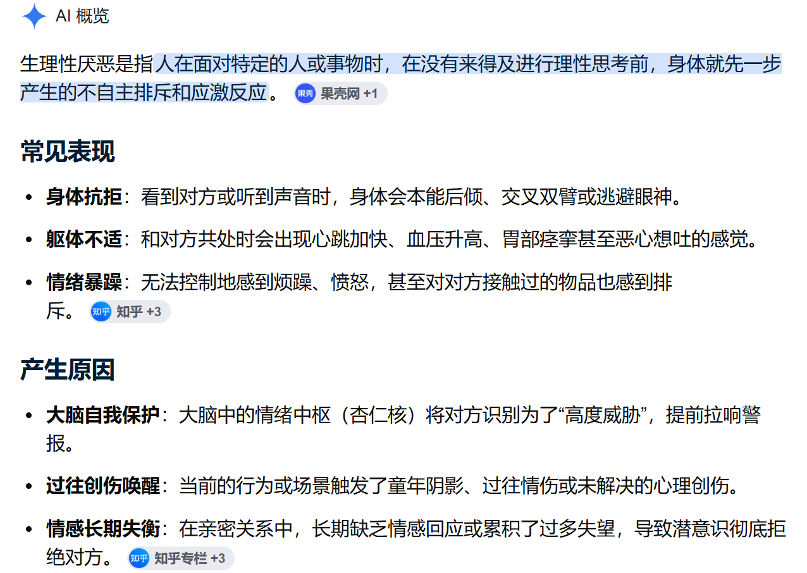

很烦躁

十分的烦躁

极端的烦躁

想砍死母亲

然后跳楼

---

对母亲早已是生理性厌恶了

她跟一块狗皮膏药一般缠粘着我

趁早死了得了

---

我怎么可能对一个

曾经拿着枪  指着我的脑袋  在我面前上好了膛  并且半扣下扳机

还一边恶狠狠辱骂着你  让我趁早滚  趁早去死

的人那里

获得任何安全感

况且那会我手无缚鸡之力

---

她发出的任何声音我都感到烦躁

做饭的声音  洗碗的声音  刷视频的声音

这些的这些

我都感到十分的不适

想极力赶走她

甚至杀死她

---

就像当年我用反锁我房间门的方法

也给母亲关在她的房间一样

或许这种方法得改进了

因为用柜子的话

毕竟是落地的

能用细长条从门缝底下用力戳开

或许直接上阻门器更好

用那种卡在门锁里的

这已经是最保守的方法了

我一直记得以前看过的一部韩国电影

主角团里的一人用高压电搭在门把手上

反派过来开门的时候

直接被电晕

不到万不得已

我懒得策划这一条

---

#

这种厌恶就不可能在对方和自己近距离的时候缓解

所谓的理解母亲

不过也是远离就她之后

自己对自己卑劣的洗脑

这些洗脑发生的前提不是说自己也去当了母亲或者父亲

而是

远离！

但是曾经受过的伤

一点也不会消除

脑子里的阴影始终还在

那些ptsd  那些应激反应  仍然伴随着一生

---

我发给父亲的死亡威胁

他无视了

我对他说  让他尽快联系娘家那边给母亲赶过去

因为

到我动手的时候

我不知道我能做出什么

比如我现在打字打着打着就想拿菜刀砍桌子

可能是双相躁狂了？

那也得拜母亲所赐了

---

十分的烦躁

这夜里还冷

时不时得脱掉外套

剩个短袖散热

她做的餐食我根本不想吃

她泡脚刷视频

占用那么长时间

我路过去热下午点的一餐外卖吃

这会我就想

要是她敢说一句话

我就能直接爆开！

就和当年初中毕业一样

直接动手把她推耸出大门外

给她一脚

关上大门  反锁

---

或许她一直在自我感动

觉得她在我身边就能慢慢拯救我

或许她在娘家那边也不受待见

但她一点也不会反思

或者说

她的大脑在积年累月的操劳与怨恨中

丧失了自我反思的能力

任何事情第一时间想到的都是别人的不好

根本不会想到自己

从始至终都是怨恨别人

这种有毒的思想习惯从小侵扰着我

使得我初中变得尖酸刻薄

直到被女生黑脸骂道 你嘴巴真贱

......

她能拯救个什么啊？！

根本不愿意了解我的任何

---

她只要在我身边或者在微信上联系我

我就会一直想死

根本不用吃药了

药也压不住

现在不仅是想死了

更是想杀了她

我意识到

我在极力地拯救我自己

企图让自己活下来

但她极力地想要杀死我

精神的杀死

物理的杀死

于是

我想杀死她！

只要她赶不走

那就是生死存亡的斗争！

